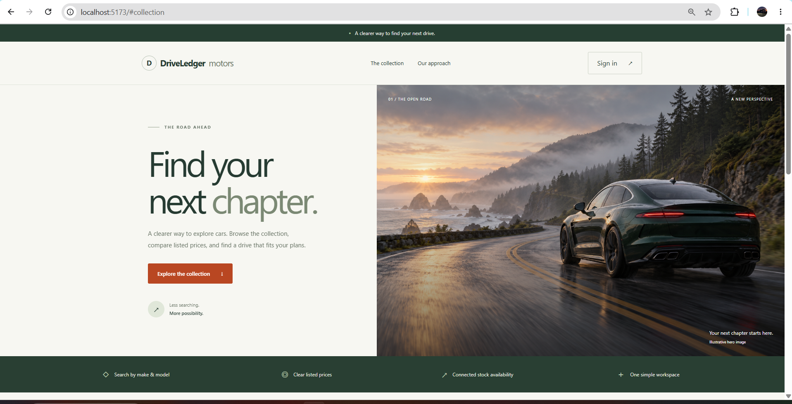
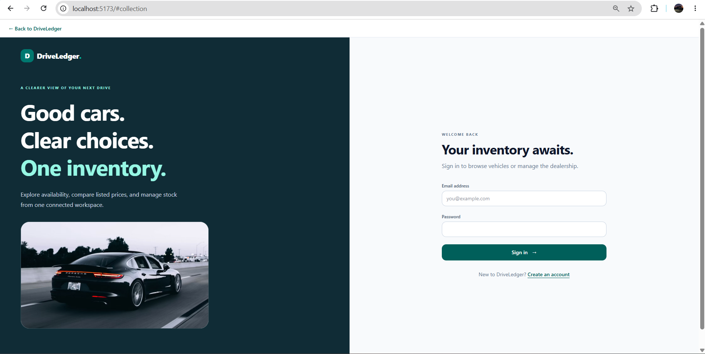
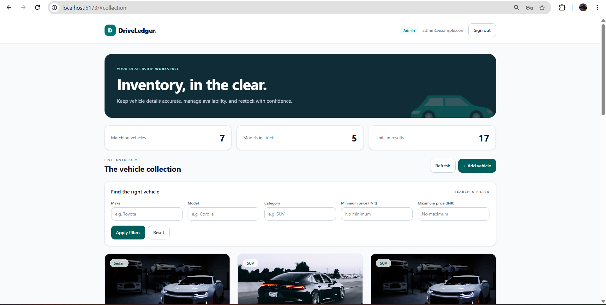

# DriveLedger — Car Dealership Inventory System

A full-stack inventory demonstration built with FastAPI, persistent
SQLite storage, React, Vite, and Tailwind CSS.

A public showroom landing page leads to registration/login.
Authenticated users can search inventory and purchase available stock.
Administrators receive a vehicle-management interface.

Purchase means reducing inventory by one unit.
No real payment is processed.

## Features

- Public showroom landing page with a locally stored hero image.
- Registration and JWT login.
- Vehicle ID, make, model, category, INR price, and stock quantity.
- Search by make, model, category, and price range.
- Vehicle creation and editing.
- Admin-only deletion and restocking.
- Stock-aware purchasing and disabled Purchase at zero stock.
- Persistent, file-backed SQLite database.
- Responsive React/Tailwind presentation.
- Representative online vehicle photographs with SVG fallback.

## Technology

- Backend: FastAPI, SQLAlchemy, Pydantic.
- Authentication: PyJWT and Argon2 password hashing.
- Database: SQLite.
- Frontend: React 18, Vite, Tailwind CSS.
- Backend testing: pytest and HTTPX.
- Frontend testing: Vitest and React Testing Library.

## Prerequisites

- Git.
- Python compatible with the backend dependency files.
- Node.js/npm compatible with the frontend dependency files.

The actual tested environment is recorded in
[docs/test-results/environment.txt](docs/test-results/environment.txt).

## Local setup

The following commands use Git Bash on Windows.

### Clone

```bash
git clone https://github.com/YashWizard/car-dealership-inventory.git
cd car-dealership-inventory
```

### Backend

```bash
cd backend
python -m venv .venv
source .venv/Scripts/activate
python -m pip install -r requirements.lock.txt
cp .env.example .env
```

On macOS/Linux, activate with `source .venv/bin/activate`.

Edit `backend/.env`:

```dotenv
DATABASE_URL=sqlite:///./dealership.db
SECRET_KEY=replace-with-your-own-random-secret-at-least-32-characters
ACCESS_TOKEN_MINUTES=60
FRONTEND_ORIGIN=http://localhost:5173
```

Generate a secret locally:

```bash
python -c "import secrets; print(secrets.token_urlsafe(48))"
```

Paste the generated value into `SECRET_KEY`.
Do not commit `.env` or publish the secret.

Create a local administrator and optional sample inventory:

```bash
python -m app.seed --email admin@example.com --sample
```

Choose a password at the prompt.
There is no published default administrator password.
Rerunning this command does not reset an existing admin password.
Sample vehicles are inserted only when inventory is empty.

Run from `backend/`:

```bash
python -m uvicorn app.main:app --reload --host 127.0.0.1 --port 8000
```

- API docs: http://127.0.0.1:8000/docs
- Health: http://127.0.0.1:8000/api/health

With the example configuration and commands run from `backend/`,
the database file is `backend/dealership.db`.
Do not delete the database to restart the application.

### Frontend

Open another terminal. From the repository root:

```bash
cd frontend
npm ci
cp .env.example .env
npm run dev
```

The frontend environment value is:

```dotenv
VITE_API_URL=http://127.0.0.1:8000
```

Do not append `/api`; request paths already include it.

Open http://localhost:5173.
Keep both servers running.
Use that exact frontend origin with the example CORS configuration.

### Windows Command Prompt alternative

After installing dependencies and preparing configuration:

Backend:

```bat
cd backend
.venv\Scripts\python.exe -m uvicorn app.main:app --reload --host 127.0.0.1 --port 8000
```

Frontend, in another window:

```bat
cd frontend
npm run dev
```

## Accounts and permissions

Public registration creates ordinary users.
The local seed command creates an administrator.

The admin management UI is intentionally hidden from ordinary users.
As documented in `docs/decisions.md`, authenticated users may call the
create/update API routes; delete and restock require server-side admin
authorization.

Frontend visibility is not a security boundary.

See [implementation decisions](docs/decisions.md).

## API endpoints

All vehicle and inventory endpoints require authentication.

| Method | Endpoint | Purpose |
|---|---|---|
| POST | `/api/auth/register` | Register an ordinary user |
| POST | `/api/auth/login` | Obtain a JWT |
| GET | `/api/vehicles` | List inventory |
| GET | `/api/vehicles/search` | Search/filter |
| POST | `/api/vehicles` | Add vehicle |
| PUT | `/api/vehicles/{id}` | Update vehicle |
| DELETE | `/api/vehicles/{id}` | Delete; admin only |
| POST | `/api/vehicles/{id}/purchase` | Purchase one unit |
| POST | `/api/vehicles/{id}/restock` | Add stock; admin only |

Search parameters:
`make`, `model`, `category`, `min_price`, `max_price`.

Prices use INR. Sample prices are illustrative data, not market quotes.
Zero-stock vehicles remain visible.

## Testing

Backend, from `backend/` with its environment active:

```bash
python -m pytest -q
```

Frontend, from `frontend/`:

```bash
npm test
npm run build
```

Recorded final run:
- Backend: 56 passed, 1 deprecation warning.
- Frontend: 12 passed across 3 test files.
- Frontend production build: successful.

See:
- [Test report and tested revision](docs/test-report.md)
- [Raw results](docs/test-results/)
- [Manual acceptance checklist](docs/manual-checklist.md)

Component tests are not a complete end-to-end browser suite.
No unmeasured coverage percentage is claimed.

## Screenshots

### Landing page


### Admin dashboard


### Admin inventory


## My AI Usage

### Tools and assistance

I used substantial Perplexity assistance to interpret the assignment,
plan the implementation, generate backend/frontend code and tests,
prepare terminal commands, draft documentation, and debug errors.

Codex UI exploration was also used as a visual reference.
The current landing-page implementation was written through
Perplexity-assisted commands rather than imported from the exported
Codex frontend. The supplied hero image was added separately.

### My role and verification

I ran the commands locally and supplied terminal results and screenshots
to guide corrections. The repository contains captured test outputs.
Manual checks are recorded separately rather than assumed to pass.

I do not claim to have written every line without AI assistance.
Generated code required correction, including heading whitespace
and a React image-attribute warning.

### Personal reflection

AI assistance helped me move faster by turning the assignment into
smaller implementation steps and helping generate code, tests, and
documentation. My role included running the commands locally, testing
the application, and sharing terminal output and screenshots so that
problems could be investigated and corrected.

This process showed me why generated code needs verification rather
than immediate acceptance. For example, we corrected a heading
whitespace issue and a React image-attribute warning, and investigated
a blank page using the browser Console. The final recorded runs showed
56 backend tests and 12 frontend tests passing, along with a successful
frontend production build.

I still need to deepen my understanding of the authentication,
authorization, and database implementation so that I can explain the
design and maintain it independently. I also recognize that passing
automated tests does not replace manual workflow checks or establish
production readiness.

### Original conversation records

See root [PROMPTS.md](PROMPTS.md) for raw conversations or verified public
chat links. AI-generated summaries are not substitutes for raw records.

## Assets

See [docs/assets.md](docs/assets.md) for image sources and provenance.
The hero image is illustrative, not an actual inventory photograph.
Card photographs are representative and are not verified model matches.

## Known limitations

- No payment processing, shipping, or reservations.
- No automatic model-specific image search.
- External card photographs depend on network/provider availability.
- The local SVG illustration is the fallback for failed card images.
- Frontend tests cover selected components rather than all workflows.
- Backend tests currently emit a Starlette/HTTPX deprecation warning.
- Production deployment, hardening, and broader accessibility testing
  are separate work.
